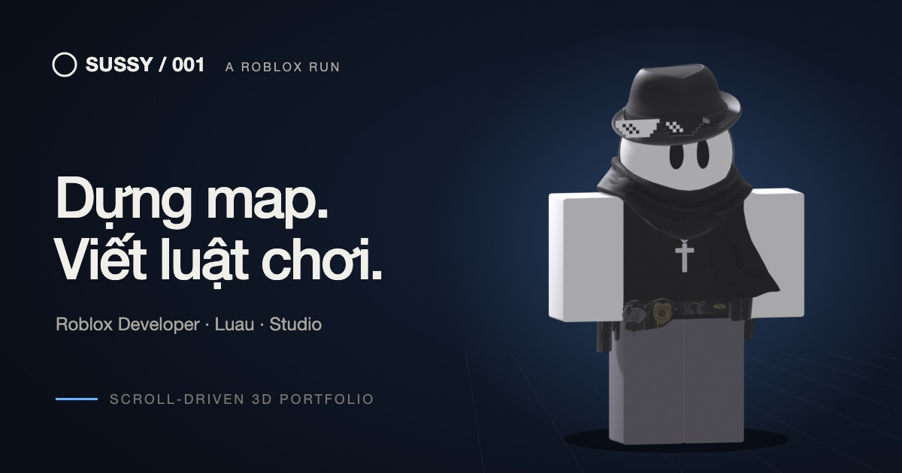

<div align="center">



# sussydev

**A scroll-driven 3D Roblox developer portfolio.**
Sussy, an R6 avatar, walks out of a studio, past a tech demo and roadside project screens, and into a sunset landscape as you scroll.

[**Live demo**](https://sussydev.vercel.app/) · [Changelog](https://sussydev.vercel.app/nhat-ky) · [Report an issue](https://github.com/VuxSussy/sussydev/issues)


</div>

> [!NOTE]
> This project is a work in progress. The live site is a finished prototype; content and contact details are still being filled in.

## Table of contents

- [Features](#features)
- [Tech stack](#tech-stack)
- [Getting started](#getting-started)
- [Scripts](#scripts)
- [Project structure](#project-structure)
- [Deployment](#deployment)
- [Credits](#credits)
- [Author](#author)

## Features

- **Scroll-driven story** — every animation is a pure function of scroll position, so scrolling backwards looks identical. Sussy walks when you scroll slowly and runs when you scroll fast.
- **Real Roblox animations** — R6 movement clips are extracted straight from `.rbxm` files and played back on a Three.js R6 rig.
- **Tech demo** — a 3D conveyor of full-colour, extruded tech logos.
- **Project demo screens** — roadside screens with a DEMO banner and a side panel for each project.
- **Project pages, changelog and CV** — `/du-an/[slug]`, `/nhat-ky` and `/cv` routes.
- **Bilingual UI** — English first, with a Vietnamese toggle.
- **Ambient music** — two chill lofi loops made in FL Studio (soft keys in the studio, strummed country guitar with a light breeze outside) that crossfade as Sussy leaves the studio. Off until the visitor turns sound on.
- **Click to hop** — Sussy only jumps when clicked.
- **Mobile-friendly** — bottom-sheet layout in portrait.

## Tech stack

| Area | Tools |
| --- | --- |
| Framework | Vinext (Next.js App Router compatible), React 19, TypeScript |
| 3D | Three.js (vanilla, no R3F), R6 rig and animation playback |
| Styling | Tailwind CSS 4, Lucide icons, Simple Icons |
| Assets | Roblox Studio, Blender (headless build scripts), glTF-Transform, FL Studio (music) |
| Quality | Oxlint, Oxfmt, Vitest, Playwright, GitHub Actions CI |
| Hosting | Vercel (via Nitro); Cloudflare Workers / Wrangler for local preview |

## Getting started

**Requirements:** Node.js 22.13 or later. Blender is *not* required — the exported models are committed.

```sh
git clone https://github.com/VuxSussy/sussydev.git
cd sussydev
npm ci
npm run dev -- --port 3002
```

Then open <http://localhost:3002>.

## Scripts

| Command | Description |
| --- | --- |
| `npm run dev` | Start the development server |
| `npm run build` | Production build into `dist/` |
| `npm start` | Serve the production build locally through Wrangler |
| `npm run lint` | Lint with Oxlint |
| `npm run format` | Format with Oxfmt |
| `npx tsc --noEmit` | Type-check |
| `npm test` | Unit and regression tests (Vitest) |
| `npm run test:e2e` | Browser tests (Playwright, see `playwright.config.ts`) |
| `npm run extract:anims` | Extract animations from a Roblox `.rbxm` file |
| `npm run build:model` / `build:nature` / `build:props` | Rebuild the 3D assets with Blender (macOS path) |

## Project structure

```text
sussydev/
├── app/                 # Routes, metadata and global styles
├── components/story/    # Portfolio UI and the WebGL scene (scene/)
├── data/                # Portfolio content, translations, case studies, changelog
├── lib/                 # Scroll maths, audio and Roblox R6 rig logic
├── public/              # Optimized models, animations and images
├── assets-src/          # Editable source assets (3D, FL Studio renders and note data)
├── scripts/             # Asset conversion and Blender build scripts
├── docs/                # Design tokens and style reference
├── tests/               # Unit and regression tests
└── e2e/                 # Playwright browser tests
```

## Deployment

The app is deployed on Vercel. `vercel.json` configures the source build, and Nitro generates the server functions and static assets.

To deploy a prebuilt output manually:

```sh
NITRO_PRESET=vercel npm run build
vercel deploy --prebuilt --prod
```

The current application lives on `main`; the `prototype` branch keeps the earlier static website.

## Credits

- The R6 avatar comes from Roblox Studio and is refined in Blender.
- Tech logos: [devicon](https://devicon.dev) (MIT), the official Luau and roblox-ts sites and [Simple Icons](https://simpleicons.org) (CC0).
- The floating hammers, tools and bricks are modelled by `scripts/blender/build-props.py`.

Brand names and logos belong to their respective owners.

## Author

<table>
  <tr>
    <td align="center">
      <a href="https://github.com/VuxSussy">
        <br />
        <b>VuxSussy</b>
      </a>
      <br />
      <sub>Student @ UIT – VNUHCM</sub>
    </td>
  </tr>
</table>

- GitHub: [@VuxSussy](https://github.com/VuxSussy)
- Repository: [VuxSussy/sussydev](https://github.com/VuxSussy/sussydev)
- Roblox: [Profile](https://www.roblox.com/users/11732948357/profile)

<div align="center">

⭐ If you like this project, consider giving it a star!

</div>
